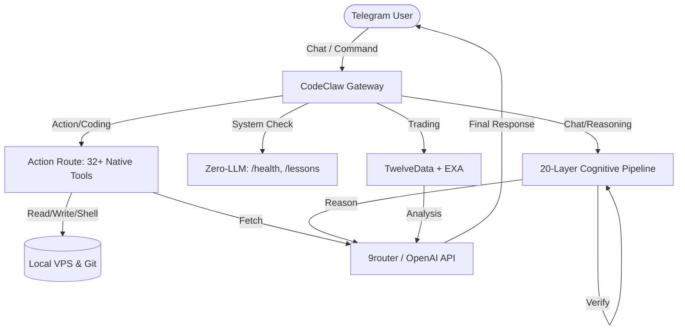

<div align="center">

# 🤖 CodeClaw Pro

**The Ultimate Autonomous AI Agent & Telegram Bot for Coding and XAU/USD Trading**

[](https://www.npmjs.com/package/@cakagus/codeclaw)
[](https://opensource.org/licenses/MIT)
[](https://nodejs.org)

*Lightweight, fast, and runs smoothly even on a 1GB RAM VPS.*

</div>

---

## 🌟 Why CodeClaw?
CodeClaw is not just another chatbot. It is an **autonomous agent** built for real-world execution, combining LLM reasoning with a robust, hallucination-free Node.js backend.

- 🧠 **20-Layer Cognitive Brain:** A conscious pipeline that prevents AI hallucinations.
- 📊 **Real-Time Trading Analysis:** Deep XAU/USD analysis using ICT/SMC, TwelveData OHLC, and EXA news.
- 🛠️ **True Tool Execution:** Reads, writes, and debugs code directly on your VPS via native shell and Git integration.
- 📚 **Self-Learning:** Autonomously researches the web and saves them as reusable skills.
- ⚡ **Zero-LLM Commands:** System checks (/health, /lessons) are hardcoded for instant, 100% accurate responses.

---
## 🏗️ System Architecture



---

## 🚀 Commands

| Category | Commands | Description |
| :--- | :--- | :--- |
| **Trading** | `/gold` `/goldplan` | Real-time XAU/USD analysis & actionable trade plans. |
| **Skill & Memory** | `/skills` `/skill` `/lessons` `/learn` `/mem` `/todo` | Manage AI memory, list skills, and trigger autonomous research. |
| **Research** | `/research_methods` | Deep dive into AI agents, trading, and dev tools. |
| **System** | `/health` `/status` `/doctor` `/start` `/help` | Instant system monitoring and bot status. |

---
## 📦 Quick Start

### 1. Install via NPM
```bash
npm install -g @cakagus/codeclaw
```

### 2. Configure Environment
Copy `config.example.json` to `config.json` and fill in your API keys:
- Telegram Bot Token
- 9router (or OpenAI-compatible) API Key
- TwelveData API Key (for Trading)
- EXA API Key (for Web Search)

### 3. Run with PM2
```bash
pm2 start bin/codeclaw.js --name codeclaw-tg --node-args="--max-old-space-size=512"
pm2 save
```

---

## 🛠️ Tech Stack
- **Runtime:** Node.js (v22+)
- **Database:** SQLite (Session & Memory) + Markdown (Skills)
- **LLM Engine:** OpenAI-Compatible (9router, Gemini, Groq, etc.)
- **Data Providers:** TwelveData (OHLC), EXA (Search API)

---

## ⚠️ Security Warning
**NEVER commit your `config.json` to GitHub.** It contains your private API keys. Ensure `config.json` is listed in your `.gitignore`.

---
<div align="center">
Made with ❤️ for autonomous AI and trading.
</div>