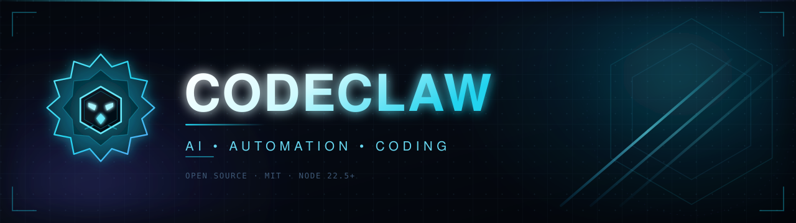

# CodeClaw Pro

<p align="center">
  
</p>

<p align="center">
  
  
  
  
  
  
</p>

Coding agent untuk terminal. Jalan di Termux (Android), Ubuntu PRoot, Linux, macOS, dan WSL. Tanpa `npm install` — cukup Node.js 22.5+.

- **30 tools** — file ops, shell, git/gh, web, code indexer, todo, memory, research, skills, brain mode
- **Self-evolving** — agent menyimpan pengalaman sukses jadi skill reusable
- **Knowledge base** — riset ArXiv + Hacker News masuk SQLite, otomatis di-inject ke prompt
- **Multi-channel** — REPL terminal dan bot Telegram
- **Multi-provider** — format `models.providers`, kompatibel API OpenAI

<p align="center">
  
</p>

---


## 📈 Market Analysis & Automation (Fitur Baru)

CodeClaw kini dilengkapi dengan mesin analisa kuantitatif dan fundamental otomatis:

- **XAU/USD (Gold) Analysis**: Menarik data harga dari Twelve Data, menghitung RSI(14), SMA(20/50), ATR(14) untuk menentukan level SL/TP berbasis volatilitas (SL & TP1 = 1.5×ATR, TP2 = 3×ATR). Membaca berita terkait The Fed (Exa AI), serta mengambil data makro (US10Y, Real Yield DFII10, VIX via FRED API). Level Entry/SL/TP hanya ditampilkan saat sinyal BUY/SELL, sedangkan untuk sinyal WAIT tidak akan ditampilkan. Laporan dikirim otomatis ke Telegram setiap pagi.
- **Automated Research**: Cron job berjalan otomatis untuk meriset jurnal ArXiv dan Hacker News, menyimpannya ke Knowledge Base.
- **Production Supervisor**: Menggunakan `run.sh` sebagai supervisor (auto-restart jika crash, heartbeat monitor, anti double-process). Bot dijamin hidup 24/7.

### Setup Cron & API Keys
Untuk mengaktifkan fitur analisa Emas, pastikan Anda mengisi API Key berikut di `config.json`:
- `twelvedata.apiKey`: Dapatkan gratis di twelvedata.com.
- `channels.telegram.accounts.default.chatId`: ID Telegram Anda (bisa diatur via panel.js).


## Daftar Isi

1. [Persyaratan](#persyaratan)
2. [Instalasi](#instalasi)
3. [Setup Provider LLM](#setup-provider-llm)
4. [Jalankan Agent](#jalankan-agent)
5. [Setup Telegram](#setup-telegram)
6. [Perintah CLI](#perintah-cli)
7. [Perintah REPL](#perintah-repl)
8. [30 Tools](#30-tools)
9. [Brain Level](#brain-level)
10. [Konfigurasi](#konfigurasi)
11. [Self-Evolving Skills](#self-evolving-skills)
12. [Troubleshooting](#troubleshooting)

---

## Persyaratan

| Kebutuhan | Versi | Catatan |
|---|---|---|
| Node.js | **>= 22.5** | Wajib. Pakai `node:sqlite` built-in |
| git | any | Clone repo, versioning |
| bash | any | Untuk shell tool |
| gh CLI | any | Opsional, untuk operasi GitHub |

Cek versi:

```bash
node -v   # harus v22.5.0 atau lebih baru
```

---

## Instalasi

### One-line install (disarankan)

```bash
curl -fsSL https://raw.githubusercontent.com/pmuhammadagus-byte/codeclaw/main/install.sh | bash
```

Script akan deteksi OS, install Node.js 22.5+ jika perlu, clone repo ke `~/codeclaw`, dan siapkan `config.json`.

### Termux (Android)

Install Termux dari **F-Droid**, jangan dari Play Store (versinya usang dan tidak bisa `pkg upgrade` normal).

```bash
pkg update -y && pkg upgrade -y
pkg install -y nodejs git
```

Lalu lanjut ke [langkah clone](#clone-repo).

### Ubuntu PRoot di Termux

```bash
pkg install -y proot-distro
proot-distro install ubuntu
proot-distro login ubuntu

# di dalam Ubuntu:
apt update && apt upgrade -y
apt install -y curl git
curl -fsSL https://deb.nodesource.com/setup_22.x | bash -
apt install -y nodejs
```

### Linux / macOS / WSL

Node 22.5+ lewat NodeSource (Debian/Ubuntu):

```bash
curl -fsSL https://deb.nodesource.com/setup_22.x | bash -
apt install -y nodejs git
```

macOS: `brew install node git`

### Clone repo

```bash
git clone https://github.com/pmuhammadagus-byte/codeclaw.git ~/codeclaw
cd ~/codeclaw
chmod +x cli.js
```

Bisa langsung jalan **tanpa `npm install`** — semua fitur inti pakai modul bawaan Node. Pastikan bisa jalan:

```bash
node cli.js
```

Opsional: `npm install` hanya untuk memasang **`undici`** (lihat catatan di bawah).

> **Soal `undici`.** Satu-satunya dependency di `package.json` adalah `undici`, dan sifatnya **opsional**. Gunanya memasang global dispatcher agar koneksi LLM dipaksa lewat IPv4 (berguna kalau jaringanmu bermasalah di IPv6, kasus umum di Termux). Tanpa `undici`, agent tetap jalan normal: `lib/ipv4-lookup.js` hanya mencatat satu baris log lalu memakai `dns.lookup` bawaan Node dengan `family: 4`. Jalankan `npm install` kalau kamu kena error koneksi/timeout ke provider LLM.

---

## Setup Provider LLM

Copy contoh config lalu isi API key:

```bash
cp config.example.json config.json
```

Struktur minimal `config.json`:

```json
{
  "models": {
    "default": "groq/llama-3.3-70b-versatile",
    "providers": {
      "groq": {
        "baseUrl": "https://api.groq.com/openai/v1",
        "apiKey": "gsk_xxx",
        "api": "openai-completions",
        "models": [
          { "id": "llama-3.3-70b-versatile", "name": "Llama 3.3 70B" }
        ]
      }
    }
  }
}
```

Referensi model selalu `provider/modelId`. Provider apa pun yang kompatibel endpoint `/chat/completions` bisa dipakai — cukup daftarkan `baseUrl` + `apiKey`.

Set model aktif:

```bash
node cli.js model list
node cli.js model set groq/llama-3.3-70b-versatile
```

Atau pakai panel interaktif:

```bash
node cli.js panel
```

---

## Jalankan Agent

```bash
node cli.js start
# atau
npm start
```

Masuk ke REPL. Ketik permintaan langsung, misalnya:

```
baca lib/tools.js lalu tambah tool baru untuk baca file JSON
```

---

## Setup Telegram

1. Buat bot lewat [@BotFather](https://t.me/BotFather), simpan token.
2. Isi config atau lewat CLI:

```bash
node cli.js channel telegram enable
node cli.js channel telegram set-token 123456:ABC-DEF...
node cli.js channel telegram allow 123456789   # Telegram user ID kamu
```

3. Jalankan:

```bash
node cli.js telegram
# atau
npm run tg
```

Ambil user ID kamu sendiri lewat [@userinfobot](https://t.me/userinfobot). Tanpa `allowedUserIds`, bot menolak semua pesan.

---

## Perintah CLI

| Perintah | Fungsi |
|---|---|
| `node cli.js` | Tampilkan help |
| `node cli.js start` | Jalankan agent (REPL) |
| `node cli.js telegram` | Jalankan bot Telegram |
| `node cli.js panel` | Panel config interaktif |
| `node cli.js model list` | Daftar model |
| `node cli.js model current` | Model aktif + detail |
| `node cli.js model set <ref>` | Ganti model aktif |
| `node cli.js model add-provider` | Tambah provider |
| `node cli.js model add-model` | Tambah model ke provider |
| `node cli.js channel telegram status` | Status channel Telegram |
| `node cli.js channel telegram enable` | Aktifkan channel |
| `node cli.js channel telegram disable` | Nonaktifkan channel |
| `node cli.js channel telegram set-token <t>` | Set bot token |
| `node cli.js channel telegram allow <id>` | Tambah user ke allowlist |
| `node cli.js channel telegram disallow <id>` | Hapus user dari allowlist |
| `node cli.js config show` | Tampilkan config (API key dimasking) |
| `node cli.js config path` | Lokasi `config.json` |
| `node cli.js config edit` | Petunjuk edit config |
| `node cli.js config migrate` | Migrasi format config lama |
| `node cli.js brain status` | Level brain aktif + daftar level |
| `node cli.js brain set <level>` | Set brain level (`off`/`normal`/`high`/`genius`) |
| `node cli.js research <topik>` | Riset ArXiv + HN → knowledge base |
| `node cli.js research stats` | Statistik knowledge base |
| `node cli.js cron status` | Status cron research |
| `node cli.js cron run` | Jalankan cron sekali |

---

## Perintah REPL

| Perintah | Fungsi |
|---|---|
| `/help` | Daftar perintah |
| `/clear` | Hapus riwayat chat + todo |
| `/todo` | Lihat daftar todo |
| `/mem` | Lihat memory tersimpan |
| `/skills` | Daftar skill + success rate |
| `/research <topik>` | Riset ArXiv + HN |
| `/knowledge` | Statistik knowledge base |
| `/ksearch <query>` | Cari di knowledge base |
| `/exit`, `/quit` | Keluar |

Perintah bot Telegram: `/start`, `/clear`, `/todo`, `/mem`, `/status`, `/whoami`, `/help`.

---

## 30 Tools

**File & kode (7):**
- `read_file` — baca dengan line numbers
- `write_file` — tulis/overwrite
- `edit_file` — replace old_text unik
- `list_dir` — list folder recursive
- `search_code` — grep seluruh codebase
- `diff_preview` — preview sebelum write
- `refactor_multi` — replace di banyak file

**Shell & Git (4):**
- `shell` — exec command (git, gh, npm, apt, curl)
- `install_package` — auto-detect npm/pip/apt/pkg
- `run_tests` — auto-detect test framework
- `parse_error` — ekstrak file:line dari stack trace

**Web (2):**
- `web_fetch` — fetch URL -> text (HTML strip)
- `web_search` — DuckDuckGo search

**Planning & Memory (3):**
- `todo_write` — plan multi-step
- `memory_set` — simpan preferensi
- `memory_get` — ambil preferensi

**RAG (2):**
- `index_codebase` — index keyword inverted
- `search_index` — cari via index

**Snapshot (2):**
- `branch_save` — snapshot sebelum risky edit
- `branch_restore` — rollback

**Self-evolving (4):**
- `skill_save` — simpan skill manual
- `skill_find` — cari skill relevan
- `skill_list` — list semua skill
- `skill_record` — catat success/fail

**Research (3):**
- `research_topic` — ArXiv + HN + GitHub trending
- `knowledge_search` — cari di KB
- `knowledge_add` — simpan catatan

**Brain Mode (2):**
- `think` — reasoning eksplisit sebelum eksekusi
- `verify` — buktikan hasil dengan command konkret

**Total: 30 tools**

---

## Brain Level

`brainLevel` mengatur seberapa ketat agent berpikir dan memverifikasi. Set lewat CLI:

```bash
node cli.js brain status
node cli.js brain set high
```

| Level | Perilaku |
|---|---|
| `off` | Tanpa ritual. Paling cepat, tanpa verifikasi wajib |
| `normal` | Pikirkan dulu untuk task kompleks, verifikasi dasar. Default aman |
| `high` | `think` + `verify` **wajib** untuk task >2 tool call. Direkomendasikan |
| `genius` | 5 fase (reasoning → planning → execution → verification → reflection) untuk semua task non-trivial |

Level tersimpan di `agent.brainLevel` dan prompt-nya di-inject tiap turn dari `lib/brain.js`.

---

## Konfigurasi

`config.json` punya beberapa blok utama:

```json
{
  "gateway": { "mode": "local", "httpPort": 3000 },
  "models":  { "default": "...", "providers": { } },
  "agents":  { "main": { "default": true, "model": "...", "systemPromptFile": "system.md" } },
  "channels":{ "telegram": { "enabled": false, "accounts": { } } },
  "agent": {
    "maxToolIterations": 30,
    "contextWindow": 80,
    "approvalMode": "dangerous-only",
    "maxSubagentDepth": 2,
    "maxSubagentIterations": 15,
    "brainLevel": "high"
  },
  "research": { "enabled": false, "topics": [], "sources": ["arxiv", "hn"] }
}
```

- `agent.approvalMode` — `dangerous-only` minta konfirmasi hanya untuk command berisiko
- `agent.maxToolIterations` — batas loop tool call per turn
- `agent.brainLevel` — `off` / `normal` / `high` / `genius`, lihat [Brain Level](#brain-level)
- `systemPromptFile` — file prompt sistem, default `system.md`

## Konfigurasi

Setiap kali aplikasi dimulai, `config.json` akan divalidasi secara ketat menggunakan **Zod**. Jika ada field dengan tipe atau format yang salah (misalnya `baseUrl` bukan URL valid, `httpPort` bukan angka positif), CodeClaw akan menolak untuk berjalan dan menampilkan pesan error yang spesifik. Periksa pesan error, perbaiki field yang dilaporkan, lalu jalankan ulang. Anda juga bisa mengisi/mengedit konfigurasi lewat `node cli.js panel`.

File yang tidak ikut ke git: `config.json`, `data.db`, `knowledge.db`, `skills/`, `.branches/`, `downloads/`.

---

## Self-Evolving Skills

Setelah task kompleks berhasil, agent bisa menyimpulkan prosedurnya jadi skill dan menyimpannya ke `skills/` (SQLite). Skill relevan otomatis dicari dan disuntik ke prompt untuk task berikutnya, jadi agent tidak mengulang kesalahan yang sama.

Kelola manual:

```bash
node cli.js start
/skills
```

Atau langsung dari shell:

```bash
node -e "import('./lib/skills.js').then(m=>{const s=new m.SkillStore();console.log(s.stats())})"
```

---

## Troubleshooting

**`SqliteError` / `node:sqlite` tidak ditemukan**
Node kamu di bawah 22.5. Upgrade: `pkg upgrade nodejs` (Termux) atau lewat NodeSource (Linux).

**Warning `ExperimentalWarning: SQLite is an experimental feature`**
Normal. Bisa diabaikan.

**`Tidak ada model`**
`config.json` belum ada atau `models.providers` kosong. Jalankan `cp config.example.json config.json` lalu isi API key, atau `node cli.js panel`.

**401 / unauthorized dari provider**
API key salah atau `baseUrl` kurang `/v1`. Cek `node cli.js model current`.

**Bot Telegram tidak merespons**
Cek `allowedUserIds` sudah berisi Telegram user ID kamu, dan `channels.telegram.enabled` bernilai `true`.

**Agent berhenti di tengah task**
Naikkan `agent.maxToolIterations` di config (default 30).

**`EACCES` saat install paket**
Jangan jalankan sebagai root kalau tidak perlu, atau pakai `install_package` dengan manager `pkg` di Termux.

---

MIT License.


## 🧠 Agentic Coding & Self-Evolution (Fitur Terbaru)

CodeClaw bukan sekadar chatbot yang menjawab pertanyaan. Ia adalah **Autonomous Software Engineer** yang bisa mengelola siklus hidup pengembangan perangkat lunak (SDLC) secara mandiri.

### Kemampuan Otonom:
- **Agentic Coding**: Memecah tugas kompleks (seperti membuat aplikasi full-stack) menjadi langkah-langkah terstruktur (`think` → `todo_write` → eksekusi → verifikasi).
- **Self-Correction**: Jika menemukan error (misal: `CORS failed`, `is not a function`), ia akan membaca log, menganalisis penyebabnya, memperbaiki kodenya sendiri, dan mengujinya ulang.
- **Learning Loop (Self-Evolving)**: Setiap tugas yang berhasil diselesaikan akan otomatis diekstrak menjadi *skill* baru di folder `skills/`. Statistik (sukses/gagal) juga diperbarui secara otomatis.
- **Full-Stack Proof**: Telah teruji membangun REST API (Node.js + Express) dan Frontend (HTML + CSS + Vanilla JS) yang saling terhubung dengan CORS dan Dynamic Hostname.

---

## 🚀 Bukti Nyata (Real-World Proof)

CodeClaw telah berhasil membangun aplikasi **Book Management (Full-Stack)** secara mandiri di dalam VPS:
1. **Backend (Book API)**: Node.js + Express, berjalan di port 3001 dengan 5 endpoint CRUD (Create, Read, Update, Delete).
2. **Frontend (Book UI)**: HTML/CSS/JS murni, berjalan di port 8080, terhubung ke API menggunakan Fetch API.
3. **Bug Fixing**: CodeClaw secara mandiri mendeteksi dan memperbaiki error `Failed to Fetch` (CORS) dan `forEach is not a function`.

---

## 🌐 Kustomisasi Bahasa & Kepribadian
Secara default, CodeClaw diatur untuk menjawab dengan **Bahasa Indonesia** (lihat `IDENTITY.md`). 
Jika Anda melakukan *fork* dan ingin mengubah kepribadian atau bahasanya, cukup edit:
- `IDENTITY.md`: Nama, peran, dan bahasa wajib.
- `SOUL.md`: Karakter, etika, dan gaya bicara.
- `system.md`: Aturan teknis dan tool calling.


## 📄 Lisensi
MIT
