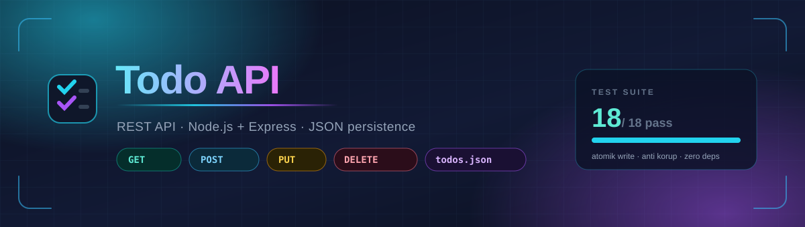
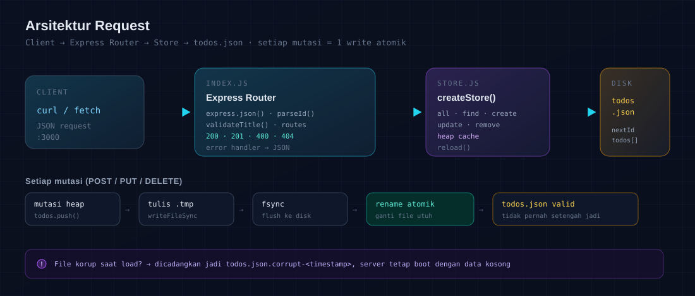

<div align="center">



<br>

[](https://github.com/OWNER/REPO/actions/workflows/test.yml)


**REST API Todo List** — Node.js + Express, data dipersist ke file JSON, **tanpa database eksternal**.

</div>

---

## Kenapa repo ini

Implementasi CRUD todo yang kecil tapi **tidak main-main soal data**: setiap mutasi ditulis
secara atomik, file rusak tidak pernah bikin server gagal boot, dan semuanya diverifikasi
oleh 18 test otomatis — tanpa satu pun dependency tambahan selain Express.

| | |
|---|---|
| **Atomic write** | `tmp` → `fsync` → `rename`. Proses mati di tengah tulis tidak merusak data lama. |
| **Anti korup** | File invalid dicadangkan ke `todos.json.corrupt-<timestamp>`, server tetap hidup. |
| **Sanitasi** | Entri rusak & `id` duplikat dibuang saat load; data valid tetap dipakai. |
| **Testable** | `createApp(store)` — test pakai file sementara, data produksi tidak tersentuh. |
| **Zero extra deps** | Test runner pakai `node:test` bawaan Node 22. |

## Arsitektur

<div align="center">

</div>

Satu arah, tanpa lapisan misterius: router memvalidasi, store menyimpan ke heap + disk,
dan setiap mutasi melewati pipeline tulis atomik yang sama.

## Mulai

```bash
git clone <repo-url> todo-api && cd todo-api
npm install
npm start                                  # http://localhost:3000
PORT=4000 npm start                        # ganti port
TODO_DATA_FILE=/path/lain.json npm start   # ganti lokasi file data
npm test                                   # 18 test (API + persistence)
```

## CI

Workflow [`.github/workflows/test.yml`](.github/workflows/test.yml) menjalankan `npm test`
otomatis pada setiap **push** dan **pull request** ke `main`, di dua versi Node (20 & 22).

Ganti placeholder badge di atas dengan repo Anda:

```diff
-https://github.com/OWNER/REPO/actions/workflows/test.yml/badge.svg?branch=main
+https://github.com/<username>/<repo>/actions/workflows/test.yml/badge.svg?branch=main
```

## Endpoint

| Method | Path | Sukses | Error | Keterangan |
|:-------|:-----|:------:|:-----:|:-----------|
| `GET` | `/todos` | **200** | 400 | List semua · filter `?completed=true\|false` |
| `GET` | `/todos/:id` | **200** | 400, 404 | Ambil satu todo |
| `POST` | `/todos` | **201** | 400 | Body: `{ "title": "..." }` |
| `PUT` | `/todos/:id` | **200** | 400, 404 | Body: `title` dan/atau `completed` |
| `DELETE` | `/todos/:id` | **200** | 400, 404 | Hapus todo |

Semua response JSON dengan bentuk konsisten:

```json
{ "success": true,  "data": { "id": 1, "title": "Beli kopi", "completed": false } }
{ "success": false, "error": "Title wajib diisi" }
```

## Contoh

```bash
# Create
curl -X POST localhost:3000/todos \
  -H "Content-Type: application/json" \
  -d '{"title":"Belajar Express"}'
# 201 {"success":true,"data":{"id":1,"title":"Belajar Express","completed":false,"createdAt":"..."}}

# Read all (filter selesai)
curl "localhost:3000/todos?completed=true"

# Update
curl -X PUT localhost:3000/todos/1 \
  -H "Content-Type: application/json" \
  -d '{"completed":true}'

# Delete
curl -X DELETE localhost:3000/todos/1
```

## Validasi

| Kasus | Status |
|:------|:------:|
| `title` tidak ada / bukan string / kosong atau whitespace saja | **400** |
| `title` otomatis di-`trim()` | — |
| `completed` bukan boolean (`"false"`, `1`) | **400** |
| `PUT` tanpa field `title` maupun `completed` | **400** |
| `id` non-numerik (`/todos/abc`) atau `0` | **400** |
| Body JSON rusak | **400** |
| Endpoint tak dikenal | **404 JSON** (bukan HTML) |
| `id` tidak ditemukan | **404** |

## Persistence

Data tersimpan di `todos.json`:

```json
{
  "nextId": 3,
  "todos": [
    { "id": 1, "title": "Beli kopi", "completed": false, "createdAt": "2025-01-01T00:00:00.000Z" },
    { "id": 2, "title": "Nulis laporan", "completed": true, "createdAt": "...", "updatedAt": "..." }
  ]
}
```

Alur tulis: **mutasi heap → tulis `.tmp` → `fsync` → `rename()`**. Kalau proses mati
di tengah jalan, `todos.json` lama tetap utuh — tidak ada file setengah jadi.

Saat load, `nextId` dinaikkan ke `max(id) + 1` bila tidak konsisten, sehingga id
tidak pernah bentrok setelah restart.

<details>
<summary><b>Perilaku saat file rusak</b></summary>

```console
$ echo '{ rusak' > todos.json && npm start
Todo API berjalan di http://localhost:3000
[store] File data korup (Expected property name or '}' in JSON at position 2) → dicadangkan sebagai todos.json.corrupt-2025-01-01T00-00-00-000Z
```

Server **tetap boot** dengan data kosong, file asli disimpan sebagai cadangan untuk
diperiksa manual.

</details>

<details>
<summary><b>Cakupan test (18)</b></summary>

**API — 12 test**: list kosong, create valid + trim, title kosong/missing, `completed`
non-boolean, update, update body kosong, filter `?completed`, 404 missing id, 400 id
non-numerik, delete lalu 404, 404 JSON untuk route tak dikenal.

**Persistence — 6 test**: file terbentuk sesuai state · data bertahan setelah restart
instance baru · delete ikut hilang dari disk · file korup dicadangkan & server jalan ·
entri rusak/duplikat dibuang · `reload()` membaca perubahan eksternal.

</details>

## Struktur

```
todo-api/
├── assets/
│   ├── banner.svg         # banner README
│   └── architecture.svg   # diagram alur request
├── index.js               # createApp(store) + routes + error handler
├── store.js               # persistence: atomic write, load, recovery
├── index.test.js          # 18 test (node:test)
├── package.json
└── todos.json             # data (gitignored)
```

<div align="center">
<sub>Dibangun dengan Node.js 22 + Express 5 · data aman, test hijau, tanpa drama.</sub>
</div>
